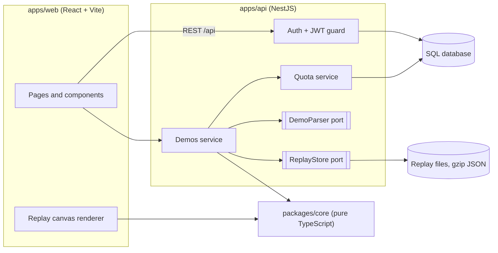

# Architecture

## Overview

## Packages

| Package     | Responsibility                                                                                                                                                                           |
| ----------- | ---------------------------------------------------------------------------------------------------------------------------------------------------------------------------------------- |
| `@cs2/core` | Domain model and pure functions: geometry, interpolation, statistics (K/D, ADR, KAST, trades), rating, tips, plan gating, daily quota, deterministic sample match. No framework, no I/O. |
| `@cs2/api`  | HTTP, persistence, authentication, upload handling, background analysis. Talks to the outside world through ports (`DemoParser`, `ReplayStore`, `Clock`).                                |
| `@cs2/web`  | Presentation. Consumes the API and the pure functions of `@cs2/core` (interpolation, calibration, quota).                                                                                |

## Request flow: analysing a demo

1. `POST /api/demos` (multipart). The JWT guard loads the user.
2. `DemosService.submit` runs under a per-user lock: quota check, file validation (extension, size, `PBDEMS2` magic header), insert.
3. The analysis runs in the background: the parser produces a `ReplayData`, the store persists it as gzipped JSON, the demo flips to `ready` (or `failed` with a code). The uploaded `.dem` is always deleted.
4. The client polls `GET /api/demos/:id`, then loads `/replay`, `/scoreboard` and `/report?player=`.
5. `/report` is built by `buildReport` and filtered by `gateReport` according to the user's plan. Locked values are `null` in the payload: they are never sent and then hidden by the UI.

## Decisions

- **Pure core, thin adapters.** Everything testable without a framework lives in `@cs2/core`; Nest and React only wire it.
- **Language-neutral tips.** The core returns tip ids and measured values; the front owns the wording (French today), which keeps i18n open.
- **Parser behind a port.** `Demoparser2Adapter` wraps `@laihoe/demoparser2`; the mapping to the replay model is a set of pure, tested functions (`replay-mapper.ts`).
- **Replays outside SQL.** Parsed matches are large documents: gzip JSON on disk (or object storage later), referenced by demo id.
- **Failed analyses do not consume quota.** A corrupt file must not burn the daily free demo.
- **Quota check serialised per user** (`KeyedMutex`). An earlier "insert then re-rank" approach was dropped because it was not race-proof.
- **SQLite for dev and tests, PostgreSQL for deployments**, selected by configuration through TypeORM.
- **No game assets.** The replay board is drawn from data on a stylised background; the sample match uses a fictional arena.
- **Validated configuration.** All environment variables are parsed with zod at startup; production refuses to start without a JWT secret.

## Known limitations (V1)

- The demoparser2 adapter is covered by tests against a mocked native module and by mapping tests on parser-shaped fixtures. **It has not been run against a real `.dem` file yet**; event and property names should be confirmed on the first real demo.
- Parsing is synchronous and CPU-bound inside the API process. V2 moves it to a job queue with a worker.
- The quota lock is in-process. With several API instances use a database or advisory lock.
- No schema migrations yet (`synchronize` is disabled in production). Add migrations before the first deployment.
- No rate limiting on the authentication endpoints yet.
- Premium is simulated by a development-only endpoint (`ENABLE_DEV_PLAN_SWITCH`). Stripe is planned for V2.
- Only the fictional sample arena has a drawn backdrop; real maps are shown on a grid until they are traced.
- The replay contains positions, kills, damage and bomb timings. Grenades are not tracked yet.
